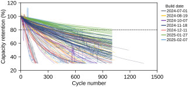
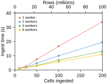

# LIBs: battery analysis without coding

Put the raw files from your cycler or potentiostat in a folder, double-click **Run LIBs**, and get publication-ready figures, a table of numbers and written findings. You don't need to open Python or a notebook.

LIBs handles one coin cell or hundreds. It ingested the 199-cell Empa dataset (about 100 million data points) in about 11 seconds on an Apple M2 laptop.



**What it analyses:** GCD and Coulombic efficiency (plating and stripping), long cycling, rate capability, dQ/dV, EIS and DRT, XPS peak fitting, CV, FTIR, SEM images, GITT and Tafel.

**Instruments it reads:** NEWARE, WonATech (WBCS and ZIVE), BioLogic (EC-Lab), IVIUM and ESPEC. It recognises the instrument from the file itself.

---

## 1. Install (once per computer)

**Step 1: Install Python.** Download it from [python.org/downloads](https://www.python.org/downloads/).
- **Windows:** in the first window of the installer, tick **"Add python.exe to PATH"**.
- **Mac:** run the installer normally.

**Step 2: Download LIBs.** On this GitHub page, click **Code → Download ZIP** and unzip it. Move the `LIBs` folder somewhere you keep your research, for example Documents.

**Step 3: Double-click the installer** in the `LIBs` folder:

| Mac | Windows |
|---|---|
| `Install LIBs (Mac).command` | `Install LIBs (Windows).bat` |

A window opens and installs everything LIBs needs (a few minutes, about 1.5 GB). When it says **"LIBs is installed"**, you're done.

> **Mac says the file "cannot be opened"?** Right-click the file, choose **Open**, then **Open** again. You only need to do this the first time.
>
> **Windows shows "Windows protected your PC"?** Click **More info → Run anyway**.

---

## 2. Analyse your data in 4 steps

Everything happens inside the `Project` folder. It's an example study you can fill with your own data.

```
LIBs/
├── Run LIBs (Mac).command       ← double-click to analyse
├── Run LIBs (Windows).bat
└── Project/
    ├── Data/        ← 1. your raw files go here
    ├── notebooks/   ← 2. settings files (config.yaml, gcd.yaml, ...)
    ├── Figures/     ← results: figures
    └── exports/     ← results: numbers and findings
```

### Step 1: Put your raw files in `Data/`

Make one folder per batch of cells, inside the folder for the technique:

```
Project/Data/GCD/Batch1/SampleA-1.ndax
Project/Data/GCD/Batch1/SampleA-2.ndax
Project/Data/GCD/Batch1/SampleB-1.ndax
```

| Technique | Folder | Files LIBs reads |
|---|---|---|
| GCD / CE (plating and stripping) | `Data/GCD/<batch>/` | NEWARE `.ndax`, `.nda`, `.xlsx`, `.csv`; WonATech ZIVE `.csv` |
| Long cycling, dQ/dV | `Data/Cycle/<batch>/` | WonATech `_Capacity.csv` + `_Cycle.csv`; ESPEC `_All.csv` |
| Rate capability | `Data/Rate/<batch>/` | the same as Cycle |
| EIS (and DRT) | `Data/EIS/<batch>/<sample>/` | IVIUM `.txt`; BioLogic `.mpt` |
| XPS | `Data/XPS/<batch>/` | Avantage workbooks or 2-column text files |
| SEM | `Data/SEM/<batch>/` | images |

**Name each file `<sample>-<number>`**, for example `SampleA-1`, `SampleA-2`. The part before the dash is the sample, and the number is the replicate cell. LIBs never changes your raw files.

### Step 2: Name your samples in `notebooks/config.yaml`

Open `Project/notebooks/config.yaml` in a text editor. On Windows, Notepad works. On a Mac, use the free [VS Code](https://code.visualstudio.com/) or [BBEdit](https://www.barebones.com/products/bbedit/), not TextEdit, which can change quote marks.

Give each sample a name and a colour. Under `aliases`, write the start of its file names:

```yaml
samples:
  - name: Bare Cu
    color: "#6B7280"
    aliases: [SampleA]
  - name: Coated Cu
    color: "#0072B2"
    aliases: [SampleB]
```

Every figure uses these names and colours. **The first sample is the reference** that the written findings compare the others against.

> **YAML rules:** keep the spaces at the start of each line exactly as they are, and use spaces, never tabs. A line starting with `#` is ignored.

### Step 3: Only for some techniques, add one setting

Most techniques need nothing more. Two do:

- **GCD needs the current density.** The easiest way is to put it in the folder name: `Data/GCD/GCD1.0/` means 1.0 mA cm⁻², and `GCD0.5` means 0.5 mA cm⁻². Without it, LIBs still draws voltage against time but can't calculate capacity or CE.
- **ESPEC files need the active mass of each channel**, because the files don't record it. See `notebooks/cycle.yaml`, section "ESPEC".

### Step 4: Double-click Run LIBs

| Mac | Windows |
|---|---|
| `Run LIBs (Mac).command` | `Run LIBs (Windows).bat` |

LIBs finds every batch in `Data/`, analyses it and opens the `Figures` folder when it's done. If you have more than one project, it asks which one.

If one batch has a problem, LIBs says which file and why, skips it, and finishes the rest.

---

## 3. What you get

| Where | What |
|---|---|
| `Figures/<technique>/<batch>/` | Figures as SVG files. They're vector files, so they stay sharp in papers and slides, and you can edit them in Illustrator, Affinity or Inkscape. |
| `exports/PlotData/` | The exact numbers behind every figure, to redraw them in Origin, SigmaPlot or Excel. |
| `exports/Features.csv` | One row per sample with every number LIBs calculated: capacity fade, CE, end-of-life forecast, resistances, and more. Opens in Excel. |
| `exports/Findings.md` | Written findings: what changed between samples, in plain sentences. Opens in any text editor. |
| `database/project.db` | Everything in one file. Open it with the free [DB Browser for SQLite](https://sqlitebrowser.org/). |

---

## 4. Change what's drawn

Each technique has its own settings file in `notebooks/` (`gcd.yaml`, `cycle.yaml`, `eis.yaml`, ...). Every setting has a comment above it that explains it.

- **Leave a cell out:** put `#` in front of its line under `cells:`.
- **Change an axis:** edit `xlim: [0, 100]` or `ylim: [0.8, 1.0]` in that figure's block.
- **Don't draw a figure:** put `#` in front of every line of its block.
- **Figure size:** `figsize: small`, `medium` or `large`.

Then double-click **Run LIBs** again. Running again is safe: LIBs replaces the old figures and numbers.

---

## 5. Start a new study

Each study gets its own project folder, with its own data, settings and results. To start one, copy the `Project` folder, rename it (for example `LMR_cathode`), and empty its `Data/` folder. **Run LIBs** will then ask which project to analyse.

---

## 6. Many cells and public datasets

LIBs can download published battery datasets, put them in one standard format, and compare hundreds of cells at once. This works for coin, pouch and cylindrical cells alike. The datasets are listed in `notebooks/datasets.yaml`:

| Dataset | Cells | Download |
|---|---|---|
| Battery Data Alliance examples | Na-ion 32140, LNMO and graphite half cells, LG M50 21700, pouch | about 25 MB |
| Empa coin cells, subset | one NMC / graphite coin cell, to try things out | 6 MB |
| Empa coin cells, full | 199 NMC / graphite coin cells | 2.5 GB, only when you ask for it by name |
| Zhu et al. 2022 | EIS of 18650 cells | 1.4 MB |

These use the terminal (see section 7), with one command per step. The full Empa set downloads only when you name it: `libs public download empa_aurora_full`.

```bash
libs public list
```
```bash
libs public download
```
```bash
libs public ingest
```
```bash
libs public figures
```

Your own large sets work the same way: add them to `datasets.yaml` (there's an example for NEWARE pouch cells in the file).



---

## 7. The terminal, for those who prefer it

Everything the double-click files do is also one command. Open Terminal (Mac) or PowerShell (Windows) in the `LIBs` folder and turn on LIBs first:

- **Mac:** `source .venv/bin/activate`
- **Windows:** `.venv\Scripts\Activate.ps1`

| Command | What it does |
|---|---|
| `libs check Project` | Shows what would be analysed and how many files it found. Writes nothing. |
| `libs run Project` | Analyses everything and draws all figures. |
| `libs run Project --only gcd eis` | Only these techniques. |
| `libs run Project --open` | Opens the Figures folder when done. |
| `libs new MyStudy` | Starts a new, empty project from the template. |
| `libs public list` / `download` / `ingest` / `figures` | Public and large datasets (section 6). |
| `libs labbook new "My electrolyte" --template electrolyte_additive` | Starts a lab-book entry. |
| `libs labbook report latest` | Makes a PDF of the latest lab-book entry. |

---

## 8. Lab book

`Project/LabBook/` is an electronic lab notebook. Write one short file per experiment, and LIBs calculates the masses to weigh and makes a PDF report. You can also link a mass you weighed into a settings file (`active_mass_g: labbook:2026-10-24a/C1`), so you never type it twice. See `Project/LabBook/HOW TO - Lab book.md`. PDF reports need [Typst](https://github.com/typst/typst/releases).

---

## 9. For Python users

Every technique also has a notebook in `Project/notebooks/` (`gcd.ipynb`, `eis.ipynb`, ...), with `run_all.ipynb` to run everything. To use them, run `jupyter lab` from the `LIBs` folder with LIBs turned on. The full technical reference, covering every instrument format, setting and the database, is in [docs/REFERENCE.md](docs/REFERENCE.md).

---

## 10. Problems

| What you see | What to do |
|---|---|
| "Python is not installed" | Install Python (section 1). On Windows, tick "Add python.exe to PATH". |
| "LIBs is not installed yet" | Double-click the Install file first. |
| "skipped …: no files in Data/…" | That batch's folder is empty. This is normal for the example batches. |
| A cell is "skipped" with a reason | Read the reason: it names the file and what was missing. |
| A legend shows a file name, not your sample name | Add the start of that file name to the sample's `aliases:` in `config.yaml`. |
| GCD has no capacity or CE | Put the current density in the folder name (`GCD1.0`) or in `gcd.yaml`. |
| A figure is cut off or empty | Widen `xlim` / `ylim` for that figure in its settings file. |
| "could not read" a NEWARE file | The test may still be running, or the file is incomplete. Export it again from BTSDA. |

Still stuck? Open an issue on this GitHub page and attach a small example of the raw file.

---

## Licence and citing

LIBs is free and open source under the MIT licence (see `LICENSE`). You may use, change and share it, including in commercial work.

If LIBs helps your research, please cite it:

> C. T. Mpupuni, *LIBs: battery analysis software*, version 1.0 (2026). https://github.com/carlostafarampupuni/LIBs

**Public datasets:** Empa, *Batteries & Supercaps* 2025, doi:10.1002/batt.202500155 · Battery Data Alliance, Battery Data Format examples, Zenodo 22230066. Cite the original authors when you use their data.

**Font:** lab-book reports use [Inter](https://github.com/rsms/inter) by Rasmus Andersson (SIL Open Font License 1.1).
